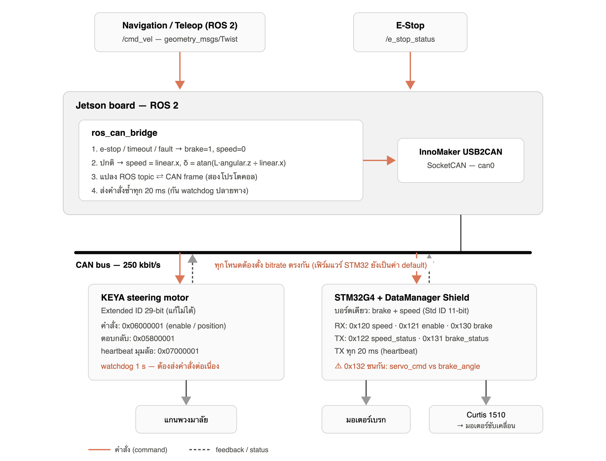

# Golf Cart Low-Level Control

ROS 2 and STM32 firmware for a drive-by-wire golf cart low-level control layer.

The Jetson Orin Nano runs the ROS 2 nodes and talks to the vehicle CAN bus through
an InnoMaker USB2CAN adapter. The STM32G4 car-shield firmware in this repository
controls the brake board. Speed commands/status are kept in the ROS bridge for a
separate speed controller board on the same CAN bus. The KEYA steering motor is
driven directly from ROS 2 over extended CAN frames.



## Repository Layout

```text
.
├── ros2_ws/
│   └── src/golfcart_low_level/        # Jetson ROS 2 package
├── firmware/
│   └── stm32_motorbrake_car_shield/   # STM32CubeIDE brake firmware
└── docs/
    └── golfcart_low_level_control_overview.png
```

## System Architecture

```text
Navigation / Teleop
  /cmd_vel
     |
Jetson Orin Nano
  golfcart_low_level
  - ros_can_bridge
  - steering_node
     |
InnoMaker USB2CAN, SocketCAN can0, 250 kbit/s
     |
CAN bus
  - STM32G4 brake board, standard 11-bit IDs
  - speed controller board, standard 11-bit IDs
  - KEYA steering motor, extended 29-bit IDs
```

The user commands the cart only through `/cmd_vel`.

- `cmd_vel.linear.x` is target speed in m/s.
- `cmd_vel.angular.z` is yaw rate in rad/s.
- `ros_can_bridge` converts yaw rate to steering angle with a bicycle model.
- `ros_can_bridge` owns speed/brake safety logic.
- `steering_node` owns KEYA motor command, heartbeat, timeout, and steering fault handling.

## CAN Protocol

The brake-side protocol below matches the current
`firmware/stm32_motorbrake_car_shield` project, synced from
`AJYui_MotorBrakeModule-main/MotorBrake_Firmware_Car_Shield`. The bus is classic
CAN, standard 11-bit IDs for STM32 frames, 250 kbit/s, so it can share the same
physical bus with the KEYA steering motor.

| CAN ID | Direction | DLC | Meaning |
|---|---|---:|---|
| `0x130` | Jetson to STM32 | 1 | brake command, byte0 `0 = release`, `1 = brake` |
| `0x131` | STM32 to Jetson | 8 | brake status heartbeat |
| `0x132` | Jetson to STM32 | 4 | brake engaged servo angle, one `float32` value in degrees |

`0x131` payload:

| Byte | Meaning |
|---|---|
| `0..3` | brake current in mA, `float32` little-endian |
| `4` | relay active |
| `5` | watchdog / e-stop / fault status, `0 = normal`, `1 = triggered` |
| `6..7` | sequence counter, `uint16` little-endian |

The ROS bridge also keeps the speed-controller CAN frames below. They require a
separate speed controller board/firmware on the same bus:

| CAN ID | Direction | DLC | Meaning |
|---|---|---:|---|
| `0x120` | Jetson to speed controller | 2 | target speed, `int16` little-endian, scale `0.01 m/s` |
| `0x121` | Jetson to speed controller | 1 | speed enable, byte0 `0/1` |
| `0x122` | speed controller to Jetson | 2 | measured speed, `int16` little-endian, scale `0.01 m/s` |

KEYA steering uses extended CAN IDs:

| CAN ID | Direction | Meaning |
|---|---|---|
| `0x06000001` | Jetson to KEYA | enable / disable / position command |
| `0x05800001` | KEYA to Jetson | response |
| `0x07000001` | KEYA to Jetson | heartbeat |

## Jetson Orin Nano Setup

Install ROS 2 and CAN tools first. Then install project dependencies:

```bash
sudo apt update
sudo apt install -y can-utils python3-aenum python3-can python3-colcon-common-extensions
sudo apt install -y ros-$ROS_DISTRO-geometry-msgs ros-$ROS_DISTRO-std-msgs
```

Build the ROS 2 package:

```bash
cd ~/GolfCart/golfcart-low-level-control/ros2_ws
source /opt/ros/$ROS_DISTRO/setup.bash
colcon build --symlink-install
source install/setup.bash
```

Optional shell setup:

```bash
echo "source /opt/ros/$ROS_DISTRO/setup.bash" >> ~/.bashrc
echo "source ~/GolfCart/golfcart-low-level-control/ros2_ws/install/setup.bash" >> ~/.bashrc
```

## CAN Bring-Up

Connect the InnoMaker USB2CAN adapter and verify that `can0` exists:

```bash
ip link
```

Bring up the CAN interface at 250 kbit/s:

```bash
cd ~/GolfCart/golfcart-low-level-control/ros2_ws
bash src/golfcart_low_level/scripts/setup_can0.sh can0 250000
```

Or manually:

```bash
sudo ip link set can0 down
sudo ip link set can0 up type can bitrate 250000 restart-ms 100
ip -details -statistics link show can0
```

Check raw CAN traffic:

```bash
candump can0
```

Expected CAN heartbeat/status frames:

```text
can0  131   [8]  ...
can0  122   [2]  ...   # only when the separate speed controller is present
```

## Run ROS 2 Low-Level Control

Launch both low-level nodes:

```bash
cd ~/GolfCart/golfcart-low-level-control/ros2_ws
source install/setup.bash
ros2 launch golfcart_low_level low_level.launch.py
```

Useful status topics:

```bash
ros2 topic echo /lowlevel_fault
ros2 topic echo /e_stop_status
ros2 topic echo /speed_status
ros2 topic echo /brake_status
ros2 topic echo /steering_angle
ros2 topic echo /steering_fault
```

Send a stopped command first:

```bash
ros2 topic pub -r 10 /cmd_vel geometry_msgs/msg/Twist \
  "{linear: {x: 0.0}, angular: {z: 0.0}}"
```

Slow straight test, only when the vehicle is mechanically safe:

```bash
ros2 topic pub -r 10 /cmd_vel geometry_msgs/msg/Twist \
  "{linear: {x: 0.2}, angular: {z: 0.0}}"
```

## STM32 Firmware

Open this STM32CubeIDE firmware project:

```text
firmware/stm32_motorbrake_car_shield
```

Important FDCAN settings:

```text
FDCAN clock: 170 MHz
NominalPrescaler: 40
NominalTimeSeg1: 13
NominalTimeSeg2: 3
NominalSyncJumpWidth: 1
Nominal bitrate: 250 kbit/s
Sample point: 82.4%
StdFiltersNbr: 2
```

`StdFiltersNbr` is `2` because the brake firmware accepts `0x130` and `0x132`.

E-stop behavior:

```text
PD2 active-low, falling edge latches watchdog_status = 1
PD2 is re-initialized with an internal pull-up in USER CODE
```

If the e-stop circuit is not wired yet, leave PD2 idle high/open so the internal
pull-up holds it inactive. A real e-stop input should pull PD2 low. Once latched,
the watchdog/e-stop status is reported in byte 5 of `0x131`.

Build and flash the STM32 board from STM32CubeIDE. After flashing, the board
should publish `0x131` periodically at about 20 ms.

## Safety Behavior

The bridge commands a safe state when any of these conditions is true:

- e-stop/fault byte from STM32 `0x131` is active
- `/cmd_vel` timeout
- STM32 heartbeat timeout

Safe state:

```text
speed_enable = 0
target_speed = 0
brake_cmd = 1
steering_node enters safe steering state
```

The e-stop must still be hardwired to the STM32 or vehicle safety circuit. The
Jetson/ROS layer is supervision and command arbitration, not the only safety path.

## Quick Troubleshooting

No `0x131` in `candump can0`:

- Confirm Jetson, STM32 brake board, speed controller, and KEYA steering are all at 250 kbit/s.
- Check CAN_H/CAN_L polarity.
- Check 120 ohm termination at both ends of the bus.
- Check CAN transceiver power and common ground/reference.
- Confirm the STM32 firmware flashed successfully.

`/lowlevel_fault` stays true:

- Confirm `candump can0` shows `0x131`.
- Confirm byte 5 of `0x131` is not reporting e-stop/fault.
- Confirm `/cmd_vel` is being published continuously.

Steering does not move:

- Confirm KEYA heartbeat `0x07000001` appears as an extended CAN frame.
- Confirm `steering_node` is running and `/steering_fault` is false.
- Confirm `/lowlevel_fault` and `/e_stop_status` are false before expecting steering motion.

## Notes

Do not run old standalone bridge scripts at the same time as `golfcart_low_level`.
Only one process should send low-level CAN commands to the vehicle bus.
